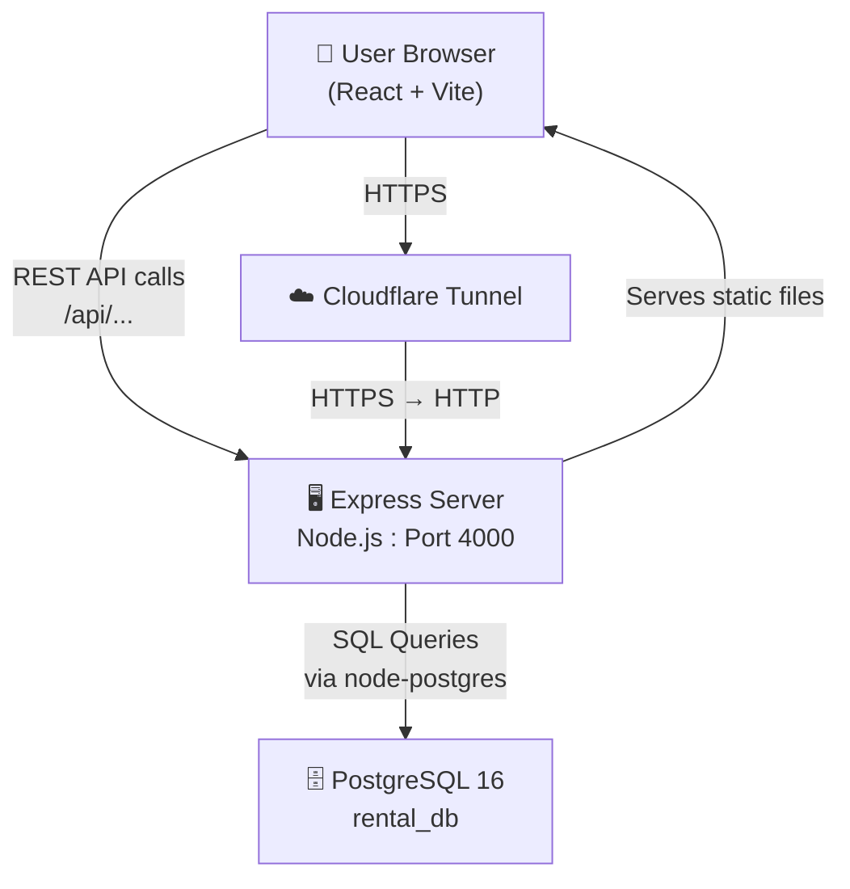
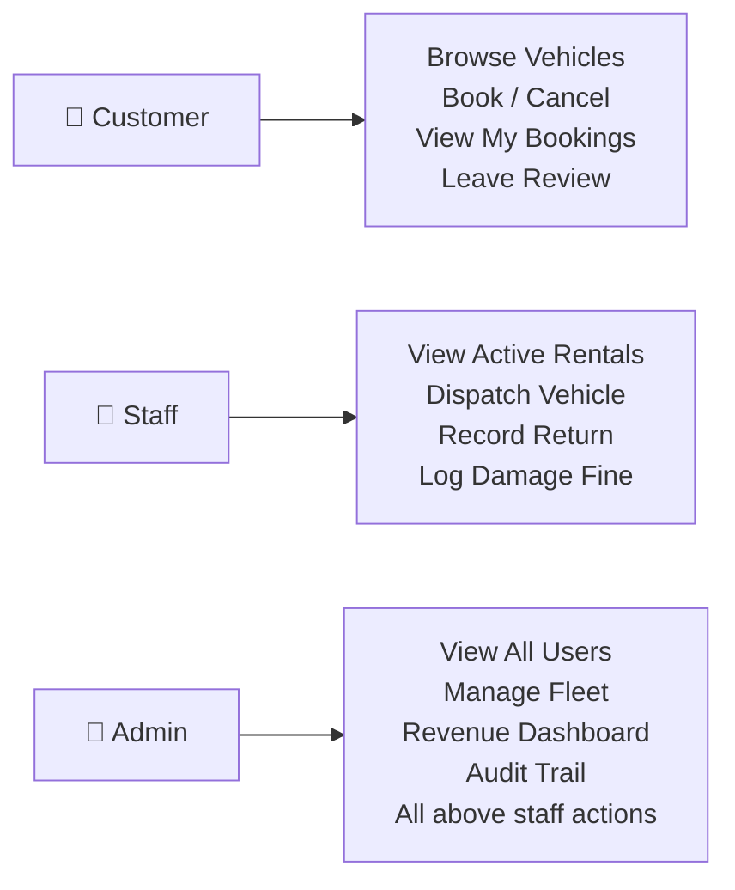

# GoDrive — Vehicle Rental Management System
## Advanced Database Management Systems (ADBMS) — Semester 5 Project Report

| Field | Details |
|---|---|
| **Project Name** | GoDrive — Vehicle Rental Management System |
| **Course** | Advanced Database Management Systems (ADBMS) |
| **Semester** | 5th Semester |
| **Database** | PostgreSQL 16 |
| **Student Name** | *(Fill your name)* |
| **Roll No.** | *(Fill your roll number)* |
| **Institution** | *(Fill your college name)* |
| **Submission Date** | November 2026 |

---

## Table of Contents

1. [Executive Summary](#1-executive-summary)
2. [System Architecture](#2-system-architecture)
3. [Technology Stack](#3-technology-stack)
4. [Database Design — Entity Relationship Diagram](#4-database-design--entity-relationship-diagram)
5. [Schema — All Tables Explained](#5-schema--all-tables-explained)
6. [ADBMS Concepts — Deep Dive](#6-adbms-concepts--deep-dive)
   - 6.1 PostgreSQL Extensions
   - 6.2 Custom ENUM Types
   - 6.3 Range Data Type (tstzrange)
   - 6.4 Exclusion Constraint (Double-Booking Prevention)
   - 6.5 PL/pgSQL Stored Functions
   - 6.6 Database Triggers
   - 6.7 Materialized View
   - 6.8 Regular Views
   - 6.9 Indexing Strategy
   - 6.10 JSONB for Audit Data
   - 6.11 Transaction Management (ACID)
   - 6.12 Session Variables for Actor Tracking
   - 6.13 Database-Level Roles & Permissions
   - 6.14 Window Functions & Aggregations
7. [API Endpoints Reference](#7-api-endpoints-reference)
8. [User Roles & Access Control](#8-user-roles--access-control)
9. [Key Business Flows with SQL](#9-key-business-flows-with-sql)
10. [Viva Q&A — 25 Expected Questions with Model Answers](#10-viva-qa--25-expected-questions-with-model-answers)
11. [Sample SQL Queries](#11-sample-sql-queries)

---

## 1. Executive Summary

**GoDrive** is a full-stack vehicle rental management system that allows customers to browse, book, and pay for cars and bikes online. Staff members can manage vehicle handovers and returns, record damage fines, and track active rentals. Administrators get a live dashboard showing revenue charts, fleet status, audit trails, and top customers.

The system is built using **React** (frontend), **Node.js / Express** (backend API), and **PostgreSQL 16** (database). It demonstrates a wide range of advanced database concepts including:

- Range data types and exclusion constraints for conflict-free bookings
- PL/pgSQL stored functions with full transaction logic
- Trigger-based automation (audit trail, status synchronisation)
- Materialized views for fast analytics
- Session variables for actor tracking across the audit trail
- Database-level roles and permission grants
- JSONB storage for flexible audit records

The database alone spans **15 tables**, **7 custom ENUM types**, **3 extensions**, **5 triggers**, **4 stored functions / procedures**, **1 materialized view**, **7 regular views**, and a comprehensive indexing strategy.

---

## 2. System Architecture

The project follows a classic **3-Tier Architecture**:



| Tier | Technology | Responsibility |
|---|---|---|
| **Presentation** | React 18 + Vite | UI rendering, role-based routing, forms |
| **Application** | Node.js + Express | REST API, auth (JWT + sessions), business validation |
| **Data** | PostgreSQL 16 | Storage, constraints, triggers, stored functions, audit |

> [!NOTE]
> The Express server also serves the compiled React build (`client/dist`), making it a single deployable unit. No separate frontend server is needed in production.

---

## 3. Technology Stack

| Category | Tool / Library | Version | Purpose |
|---|---|---|---|
| Frontend Framework | React | 18 | UI components and state management |
| Build Tool | Vite | 5 | Fast HMR, production bundling |
| Backend | Node.js + Express | 20 / 4 | REST API server |
| Database | PostgreSQL | 16 | Relational DBMS with advanced features |
| DB Client (Node) | node-postgres (`pg`) | 8 | Query execution, connection pooling |
| Auth | JWT + bcryptjs | — | Stateless token auth, password hashing |
| Tunnelling | Cloudflare Tunnel | — | Expose local server publicly over HTTPS |
| CSS | Tailwind CSS | 3 | Utility-first responsive styling |

---

## 4. Database Design — Entity Relationship Diagram

```mermaid
erDiagram
    users {
        BIGINT user_id PK
        VARCHAR full_name
        CITEXT email
        VARCHAR phone
        TEXT password_hash
        user_role role
        BOOLEAN is_active
        TIMESTAMPTZ created_at
        TIMESTAMPTZ updated_at
    }
    customer_profiles {
        BIGINT user_id PK_FK
        VARCHAR licence_no
        DATE licence_expiry
        DATE date_of_birth
        TEXT address
    }
    branches {
        INT branch_id PK
        VARCHAR name
        VARCHAR city
        TEXT address
        VARCHAR phone
    }
    vehicle_categories {
        INT category_id PK
        VARCHAR name
        NUMERIC base_daily_rate
        SMALLINT seats
    }
    vehicles {
        BIGINT vehicle_id PK
        VARCHAR reg_number
        INT category_id FK
        INT branch_id FK
        VARCHAR make
        VARCHAR model
        SMALLINT manufacture_year
        fuel_type fuel
        transmission_type transmission
        INT odometer_km
        vehicle_status status
        TEXT image_url
    }
    extras {
        INT extra_id PK
        VARCHAR name
        NUMERIC price_per_day
    }
    bookings {
        BIGINT booking_id PK
        BIGINT customer_id FK
        BIGINT vehicle_id FK
        INT pickup_branch_id FK
        INT drop_branch_id FK
        TSTZRANGE period
        NUMERIC daily_rate_snapshot
        NUMERIC total_amount
        booking_status status
    }
    booking_extras {
        BIGINT booking_id PK_FK
        INT extra_id PK_FK
        SMALLINT quantity
        NUMERIC price_per_day_snapshot
    }
    payments {
        BIGINT payment_id PK
        BIGINT booking_id FK
        NUMERIC amount
        payment_method method
        payment_status status
        VARCHAR transaction_ref
        TIMESTAMPTZ paid_at
    }
    rentals {
        BIGINT rental_id PK
        BIGINT booking_id FK
        BIGINT handed_out_by FK
        BIGINT received_by FK
        TIMESTAMPTZ pickup_at
        TIMESTAMPTZ return_at
        INT odometer_out
        INT odometer_in
    }
    damage_reports {
        BIGINT report_id PK
        BIGINT rental_id FK
        TEXT description
        NUMERIC amount
        TIMESTAMPTZ created_at
    }
    reviews {
        BIGINT review_id PK
        BIGINT booking_id FK
        SMALLINT rating
        TEXT comment
        TIMESTAMPTZ created_at
    }
    maintenance_records {
        BIGINT maintenance_id PK
        BIGINT vehicle_id FK
        TEXT description
        DATE start_date
        DATE end_date
        NUMERIC cost
    }
    audit_log {
        BIGINT audit_id PK
        TEXT table_name
        BIGINT record_id
        TEXT action
        JSONB old_data
        JSONB new_data
        BIGINT changed_by
        TIMESTAMPTZ changed_at
    }

    users ||--o| customer_profiles : "has profile"
    users ||--o{ bookings : "makes"
    vehicles ||--o{ bookings : "booked in"
    branches ||--o{ bookings : "pickup"
    branches ||--o{ bookings : "drop"
    bookings ||--o{ booking_extras : "has"
    extras ||--o{ booking_extras : "included in"
    bookings ||--o{ payments : "paid via"
    bookings ||--o| rentals : "fulfilled by"
    rentals ||--o{ damage_reports : "has"
    bookings ||--o| reviews : "reviewed"
    vehicles ||--o{ maintenance_records : "serviced"
    vehicles }o--|| vehicle_categories : "belongs to"
    vehicles }o--|| branches : "stationed at"
    users ||--o{ rentals : "handed out by"
```

---

## 5. Schema — All Tables Explained

### 5.1 `users`
The central identity table for all system actors.

```sql
CREATE TABLE users(
    user_id      BIGINT GENERATED ALWAYS AS IDENTITY PRIMARY KEY,
    full_name    VARCHAR(100) NOT NULL,
    email        CITEXT NOT NULL UNIQUE,          -- case-insensitive text
    phone        VARCHAR(15) NOT NULL CHECK(phone ~ '^[0-9+ -]{10,15}$'),
    password_hash TEXT NOT NULL,
    role         user_role NOT NULL DEFAULT 'customer',
    is_active    BOOLEAN NOT NULL DEFAULT TRUE,
    created_at   TIMESTAMPTZ NOT NULL DEFAULT now(),
    updated_at   TIMESTAMPTZ NOT NULL DEFAULT now()
);
```
**Key points:**
- `CITEXT` extension makes email lookups case-insensitive (`admin@Example.com` = `admin@example.com`)
- `GENERATED ALWAYS AS IDENTITY` — modern PostgreSQL alternative to `SERIAL`, prevents manual ID insertion
- Phone validated with a regex `CHECK` constraint
- `updated_at` is auto-managed by a **BEFORE UPDATE trigger** (`trg_users_updated`)

---

### 5.2 `customer_profiles`
Extends `users` for customers only (1-to-1 relationship).

```sql
CREATE TABLE customer_profiles(
    user_id       BIGINT PRIMARY KEY REFERENCES users ON DELETE CASCADE,
    licence_no    VARCHAR(30) NOT NULL UNIQUE,
    licence_expiry DATE NOT NULL,
    date_of_birth  DATE NOT NULL,
    address        TEXT
);
```
**Key points:**
- `ON DELETE CASCADE` — if a user is deleted, their profile is auto-deleted
- `licence_expiry` is checked inside the `create_booking()` stored function to ensure validity at rental end date

---

### 5.3 `branches`
Physical rental locations.

```sql
CREATE TABLE branches(
    branch_id INT GENERATED ALWAYS AS IDENTITY PRIMARY KEY,
    name      VARCHAR(80) NOT NULL UNIQUE,
    city      VARCHAR(60) NOT NULL,
    address   TEXT NOT NULL,
    phone     VARCHAR(15)
);
```
Currently seeded with 3 cities: **Chandigarh, Delhi, Jaipur**.

---

### 5.4 `vehicle_categories`
Groups vehicles by type with a base pricing rate.

```sql
CREATE TABLE vehicle_categories(
    category_id    INT GENERATED ALWAYS AS IDENTITY PRIMARY KEY,
    name           VARCHAR(40) NOT NULL UNIQUE,
    base_daily_rate NUMERIC(10,2) NOT NULL CHECK(base_daily_rate > 0),
    seats          SMALLINT NOT NULL CHECK(seats BETWEEN 1 AND 15)
);
```
Categories seeded: **Hatchback, SUV, Bike, Van, Sedan**.

---

### 5.5 `vehicles`
Core fleet table.

```sql
CREATE TABLE vehicles(
    vehicle_id       BIGINT GENERATED ALWAYS AS IDENTITY PRIMARY KEY,
    reg_number       VARCHAR(15) NOT NULL UNIQUE,
    category_id      INT NOT NULL REFERENCES vehicle_categories,
    branch_id        INT NOT NULL REFERENCES branches,
    make             VARCHAR(40) NOT NULL,
    model            VARCHAR(40) NOT NULL,
    manufacture_year SMALLINT NOT NULL CHECK(manufacture_year BETWEEN 2000 AND 2100),
    fuel             fuel_type NOT NULL,
    transmission     transmission_type NOT NULL,
    odometer_km      INT NOT NULL DEFAULT 0 CHECK(odometer_km >= 0),
    status           vehicle_status NOT NULL DEFAULT 'available',
    image_url        TEXT,
    created_at       TIMESTAMPTZ NOT NULL DEFAULT now()
);
```
**Key points:**
- `status` is an ENUM (`available`, `rented`, `maintenance`, `retired`) — updated automatically by trigger
- `odometer_km` updated automatically when a rental is returned (via `fn_rental_status_sync` trigger)
- 30 vehicles seeded across 5 categories

---

### 5.6 `bookings` ⭐ Most Important Table

```sql
CREATE TABLE bookings(
    booking_id         BIGINT GENERATED ALWAYS AS IDENTITY PRIMARY KEY,
    customer_id        BIGINT NOT NULL REFERENCES users,
    vehicle_id         BIGINT NOT NULL REFERENCES vehicles,
    pickup_branch_id   INT NOT NULL REFERENCES branches,
    drop_branch_id     INT NOT NULL REFERENCES branches,
    period             TSTZRANGE NOT NULL,          -- Range data type!
    daily_rate_snapshot NUMERIC(10,2) NOT NULL CHECK(daily_rate_snapshot > 0),
    total_amount       NUMERIC(10,2) NOT NULL CHECK(total_amount >= 0),
    status             booking_status NOT NULL DEFAULT 'pending',
    created_at         TIMESTAMPTZ NOT NULL DEFAULT now(),
    
    -- Validates the range is finite and non-empty
    CHECK(NOT lower_inf(period) AND NOT upper_inf(period) AND lower(period) < upper(period)),
    
    -- THE KEY ADBMS CONSTRAINT: Prevents double-booking!
    CONSTRAINT no_double_booking
        EXCLUDE USING gist(vehicle_id WITH =, period WITH &&)
        WHERE (status IN ('pending','confirmed','active'))
);
```
> [!IMPORTANT]
> `period TSTZRANGE` stores the entire rental period as a **range** (start → end inclusive) in one column. The `no_double_booking` exclusion constraint uses a **GiST index** to prevent two overlapping bookings for the same vehicle at the database level — not just in application code.

---

### 5.7 `payments`
Financial ledger for bookings.

```sql
CREATE TABLE payments(
    payment_id     BIGINT GENERATED ALWAYS AS IDENTITY PRIMARY KEY,
    booking_id     BIGINT NOT NULL REFERENCES bookings,
    amount         NUMERIC(10,2) NOT NULL CHECK(amount > 0),
    method         payment_method NOT NULL,
    status         payment_status NOT NULL,          -- paid / refunded / failed
    transaction_ref VARCHAR(60) UNIQUE,
    paid_at        TIMESTAMPTZ NOT NULL DEFAULT now()
);
```
**Key point:** One booking can have **multiple** payment rows — the initial payment, refunds, and damage fines are all separate rows in this table. Net revenue = SUM(paid) - SUM(refunded).

---

### 5.8 `rentals`
Tracks physical vehicle handover and return.

```sql
CREATE TABLE rentals(
    rental_id    BIGINT GENERATED ALWAYS AS IDENTITY PRIMARY KEY,
    booking_id   BIGINT NOT NULL UNIQUE REFERENCES bookings,
    handed_out_by BIGINT NOT NULL REFERENCES users,     -- staff who gave the car
    received_by   BIGINT REFERENCES users,              -- staff who took it back
    pickup_at    TIMESTAMPTZ NOT NULL DEFAULT now(),
    return_at    TIMESTAMPTZ,                           -- NULL until returned
    odometer_out INT NOT NULL CHECK(odometer_out >= 0),
    odometer_in  INT,
    CHECK(odometer_in IS NULL OR odometer_in >= odometer_out),
    CHECK(return_at IS NULL OR return_at >= pickup_at)
);
```
**Key point:** `return_at` being `NULL` means the car is currently out. When staff sets `return_at`, the `fn_rental_status_sync` trigger fires and marks the booking as `completed` and the vehicle as `available`.

---

### 5.9 `damage_reports`
Records damage with fine amount when a vehicle is returned.

```sql
CREATE TABLE damage_reports(
    report_id   BIGINT GENERATED ALWAYS AS IDENTITY PRIMARY KEY,
    rental_id   BIGINT NOT NULL REFERENCES rentals ON DELETE CASCADE,
    description TEXT NOT NULL,
    amount      NUMERIC(10,2) NOT NULL DEFAULT 0 CHECK(amount >= 0),
    created_at  TIMESTAMPTZ NOT NULL DEFAULT now()
);
```

---

### 5.10 `audit_log`
Complete, tamper-resistant record of every change in the system.

```sql
CREATE TABLE audit_log(
    audit_id   BIGINT GENERATED ALWAYS AS IDENTITY PRIMARY KEY,
    table_name TEXT NOT NULL,
    record_id  BIGINT,
    action     TEXT NOT NULL CHECK(action IN ('INSERT','UPDATE','DELETE')),
    old_data   JSONB,         -- previous row state
    new_data   JSONB,         -- new row state
    changed_by BIGINT,        -- user_id who made the change
    changed_at TIMESTAMPTZ NOT NULL DEFAULT now()
);
```
**Key points:**
- `old_data` and `new_data` are `JSONB` — the entire row is serialized as JSON
- `changed_by` is set via PostgreSQL session variable `app.current_user_id`
- The `rental_app` DB role **cannot INSERT/UPDATE/DELETE** this table — only triggers can write to it

---

### 5.11 Other Tables

| Table | Purpose |
|---|---|
| `extras` | Add-on items (GPS, child seat, insurance) with daily price |
| `booking_extras` | Many-to-many join: which extras are on which booking |
| `reviews` | Customer rating (1–5 stars) + comment after a completed rental |
| `maintenance_records` | Log of scheduled/unscheduled vehicle servicing |

---

## 6. ADBMS Concepts — Deep Dive

### 6.1 PostgreSQL Extensions

Three extensions are loaded before schema creation:

```sql
CREATE EXTENSION IF NOT EXISTS btree_gist;  -- Enables GiST index on scalar types (needed for exclusion constraint)
CREATE EXTENSION IF NOT EXISTS citext;       -- Case-insensitive text type
CREATE EXTENSION IF NOT EXISTS pgcrypto;     -- gen_random_uuid() for transaction references
```

**Why `btree_gist`?**  
GiST (Generalized Search Tree) natively supports range types. `btree_gist` extends it to also support equality comparisons on scalar columns (like `vehicle_id`). This is **required** for the `EXCLUDE USING gist(vehicle_id WITH =, period WITH &&)` constraint — without it, PostgreSQL cannot build the multi-column GiST index.

---

### 6.2 Custom ENUM Types

ENUM types restrict a column to a fixed set of values, enforced at the database level:

```sql
CREATE TYPE user_role         AS ENUM ('customer', 'staff', 'admin');
CREATE TYPE vehicle_status    AS ENUM ('available', 'maintenance', 'retired', 'rented');
CREATE TYPE fuel_type         AS ENUM ('petrol', 'diesel', 'electric', 'hybrid', 'cng');
CREATE TYPE transmission_type AS ENUM ('manual', 'automatic');
CREATE TYPE booking_status    AS ENUM ('pending', 'confirmed', 'active', 'completed', 'cancelled');
CREATE TYPE payment_method    AS ENUM ('card', 'upi', 'netbanking', 'cash');
CREATE TYPE payment_status    AS ENUM ('paid', 'refunded', 'failed');
```

**Benefits:**
- Database rejects any invalid value (e.g., inserting `status = 'unknown'` raises an error)
- Storage-efficient (stored as integers internally)
- Self-documenting schema
- Safe to use in `CHECK` constraints and trigger conditions

---

### 6.3 Range Data Type (`tstzrange`) ⭐

The `bookings.period` column stores the **entire rental period** as a PostgreSQL range:

```sql
period TSTZRANGE NOT NULL
-- Example value: ["2026-11-20 10:00:00+05:30","2026-11-23 10:00:00+05:30")
```

**Range Operators Used:**

| Operator | Meaning | Used Where |
|---|---|---|
| `&&` | Ranges overlap | `no_double_booking` constraint |
| `lower(period)` | Extract start timestamp | Refund calculation in `cancel_booking()` |
| `upper(period)` | Extract end timestamp | Licence expiry check in `create_booking()` |
| `lower_inf(period)` | Is start unbounded? | CHECK constraint validation |
| `tstzrange(start, end, '[)')` | Create half-open range | Insert in `create_booking()` |

**Why use a range instead of two separate columns?**  
A single `TSTZRANGE` column enables:
1. The **exclusion constraint** (you can't express `&&` on two separate timestamp columns)
2. Built-in containment, overlap, and adjacency checks
3. Cleaner queries and indexes

---

### 6.4 Exclusion Constraint (Double-Booking Prevention) ⭐⭐

This is the **most important ADBMS feature** in the project.

```sql
CONSTRAINT no_double_booking
    EXCLUDE USING gist(vehicle_id WITH =, period WITH &&)
    WHERE (status IN ('pending', 'confirmed', 'active'))
```

**How it works:**

1. When a new booking is inserted, PostgreSQL checks the GiST index
2. It looks for any existing row where:
   - `vehicle_id` is **equal** (`=`) to the new booking's vehicle
   - `period` **overlaps** (`&&`) with the new booking's period
   - The existing booking is `pending`, `confirmed`, or `active` (not cancelled/completed)
3. If such a row exists → the INSERT is **rejected** with an `exclusion_violation` error
4. This is handled in `create_booking()` with `EXCEPTION WHEN exclusion_violation THEN ...`

**Why not just use application-level checking?**
- Race conditions: two requests arriving simultaneously could both pass a "is vehicle available?" check and both proceed to insert, causing double-booking
- The database exclusion constraint is **atomic** — it cannot be bypassed by concurrent transactions

> [!CAUTION]
> This requires `btree_gist` extension. Without it, PostgreSQL cannot create a GiST index on `BIGINT` (vehicle_id).

---

### 6.5 PL/pgSQL Stored Functions

#### `create_booking()` — Full Atomic Booking Transaction

```sql
CREATE OR REPLACE FUNCTION create_booking(
    p_customer_id  BIGINT,
    p_vehicle_id   BIGINT,
    p_start        TIMESTAMPTZ,
    p_end          TIMESTAMPTZ,
    p_pickup_branch INT,
    p_drop_branch   INT,
    p_method       payment_method,
    p_extra_ids    INT[] DEFAULT '{}'
) RETURNS BIGINT LANGUAGE plpgsql AS $$
DECLARE
    v_rate  NUMERIC(10,2);
    v_days  INT;
    v_total NUMERIC(10,2);
    v_id    BIGINT;
    v_extra NUMERIC(10,2);
BEGIN
    -- Step 1: Validate date range
    IF p_end <= p_start THEN RAISE EXCEPTION 'End must be after start'; END IF;
    IF p_start < now() - INTERVAL '5 minutes' THEN RAISE EXCEPTION 'Start date is in the past'; END IF;

    -- Step 2: Validate customer eligibility (active + valid licence)
    IF NOT EXISTS(
        SELECT 1 FROM users u
        JOIN customer_profiles cp USING(user_id)
        WHERE u.user_id = p_customer_id
          AND u.role = 'customer'
          AND u.is_active
          AND cp.licence_expiry >= p_end::date
    ) THEN
        RAISE EXCEPTION 'Customer not eligible: active account and valid licence required';
    END IF;

    -- Step 3: Lock the vehicle row (FOR UPDATE prevents race conditions)
    SELECT c.base_daily_rate INTO v_rate
    FROM vehicles v JOIN vehicle_categories c USING(category_id)
    WHERE v.vehicle_id = p_vehicle_id AND v.status = 'available'
    FOR UPDATE OF v;
    IF NOT FOUND THEN RAISE EXCEPTION 'Vehicle not available'; END IF;

    -- Step 4: Calculate pricing
    v_days  := GREATEST(1, CEIL(EXTRACT(EPOCH FROM(p_end - p_start)) / 86400)::INT);
    SELECT COALESCE(SUM(price_per_day), 0) INTO v_extra
    FROM extras WHERE extra_id = ANY(p_extra_ids);
    v_total := v_days * (v_rate + v_extra);

    -- Step 5: Insert booking (exclusion constraint enforced here)
    INSERT INTO bookings(customer_id, vehicle_id, pickup_branch_id, drop_branch_id,
                         period, daily_rate_snapshot, total_amount, status)
    VALUES(p_customer_id, p_vehicle_id, p_pickup_branch, p_drop_branch,
           tstzrange(p_start, p_end, '[)'), v_rate, v_total, 'confirmed')
    RETURNING booking_id INTO v_id;

    -- Step 6: Insert extras and payment atomically
    INSERT INTO booking_extras
    SELECT v_id, e.extra_id, 1, e.price_per_day
    FROM extras e WHERE e.extra_id = ANY(p_extra_ids);

    INSERT INTO payments(booking_id, amount, method, status, transaction_ref)
    VALUES(v_id, v_total, p_method, 'paid', 'TXN-' || gen_random_uuid());

    RETURN v_id;

EXCEPTION
    WHEN exclusion_violation THEN
        RAISE EXCEPTION 'Vehicle is already booked for these dates';
END $$;
```

**This function is fully ACID:**
- If any step fails (e.g., double-booking detected), the entire function rolls back — no orphan bookings or payments
- `FOR UPDATE OF v` on the vehicle row prevents concurrent transactions from booking the same car simultaneously

---

#### `cancel_booking()` — Smart Refund Logic

```sql
CREATE OR REPLACE FUNCTION cancel_booking(
    p_booking_id BIGINT,
    p_customer_id BIGINT
) RETURNS NUMERIC LANGUAGE plpgsql AS $$
DECLARE
    b          bookings%ROWTYPE;
    refund     NUMERIC(10,2);
    pay_method payment_method;
BEGIN
    -- Lock the booking row
    SELECT * INTO b FROM bookings
    WHERE booking_id = p_booking_id AND customer_id = p_customer_id
    FOR UPDATE;
    IF NOT FOUND THEN RAISE EXCEPTION 'Booking not found'; END IF;

    IF b.status NOT IN('pending','confirmed') THEN
        RAISE EXCEPTION 'Cannot cancel a booking that is %', b.status;
    END IF;

    -- Find original payment method for the refund
    SELECT method INTO pay_method FROM payments
    WHERE booking_id = b.booking_id AND status = 'paid'
    ORDER BY paid_at LIMIT 1;

    -- Refund policy: 100% if >24hrs before pickup, else 50%
    refund := CASE
        WHEN lower(b.period) - now() >= interval '24 hours'
        THEN b.total_amount
        ELSE ROUND(b.total_amount * 0.5, 2)
    END;

    UPDATE bookings SET status = 'cancelled' WHERE booking_id = b.booking_id;

    IF refund > 0 THEN
        INSERT INTO payments(booking_id, amount, method, status, transaction_ref)
        VALUES(b.booking_id, refund, pay_method, 'refunded', 'RFD-' || gen_random_uuid());
    END IF;

    RETURN refund;
END $$;
```

---

### 6.6 Database Triggers

#### Trigger 1: `trg_users_updated` — Auto-timestamp on update

```sql
CREATE OR REPLACE FUNCTION fn_set_updated_at() RETURNS trigger LANGUAGE plpgsql AS $$
BEGIN
    NEW.updated_at := now();
    RETURN NEW;
END $$;

CREATE TRIGGER trg_users_updated
    BEFORE UPDATE ON users
    FOR EACH ROW EXECUTE FUNCTION fn_set_updated_at();
```
Every time a user row is updated, `updated_at` is automatically set to the current time — no application code needs to manage this.

---

#### Trigger 2: `trg_audit_*` — Universal Audit Trail

```sql
CREATE OR REPLACE FUNCTION fn_audit() RETURNS trigger LANGUAGE plpgsql AS $$
DECLARE rec JSONB;
BEGIN
    rec := CASE WHEN TG_OP = 'DELETE' THEN to_jsonb(OLD) ELSE to_jsonb(NEW) END;

    INSERT INTO audit_log(table_name, record_id, action, old_data, new_data, changed_by)
    VALUES(
        TG_TABLE_NAME,
        (rec ->> TG_ARGV[0])::BIGINT,              -- e.g. 'booking_id' passed as argument
        TG_OP,
        CASE WHEN TG_OP IN ('UPDATE','DELETE') THEN to_jsonb(OLD) END,
        CASE WHEN TG_OP IN ('INSERT','UPDATE') THEN to_jsonb(NEW) END,
        NULLIF(current_setting('app.current_user_id', true), '')::BIGINT
    );
    RETURN NULL;  -- AFTER trigger, return value ignored
END $$;
```

This **one function** is attached to **seven tables**:

```sql
CREATE TRIGGER trg_bookings_audit AFTER INSERT OR UPDATE OR DELETE ON bookings FOR EACH ROW EXECUTE FUNCTION fn_audit('booking_id');
CREATE TRIGGER trg_vehicles_audit AFTER INSERT OR UPDATE OR DELETE ON vehicles FOR EACH ROW EXECUTE FUNCTION fn_audit('vehicle_id');
CREATE TRIGGER trg_rentals_audit  AFTER INSERT OR UPDATE OR DELETE ON rentals  FOR EACH ROW EXECUTE FUNCTION fn_audit('rental_id');
CREATE TRIGGER trg_payments_audit AFTER INSERT OR UPDATE OR DELETE ON payments FOR EACH ROW EXECUTE FUNCTION fn_audit('payment_id');
CREATE TRIGGER trg_users_audit    AFTER INSERT OR UPDATE OR DELETE ON users    FOR EACH ROW EXECUTE FUNCTION fn_audit('user_id');
CREATE TRIGGER trg_damage_audit   AFTER INSERT OR UPDATE OR DELETE ON damage_reports FOR EACH ROW EXECUTE FUNCTION fn_audit('report_id');
CREATE TRIGGER trg_reviews_audit  AFTER INSERT OR UPDATE OR DELETE ON reviews  FOR EACH ROW EXECUTE FUNCTION fn_audit('review_id');
```

**Key trigger concepts demonstrated:**
- `TG_OP` — special trigger variable: `'INSERT'`, `'UPDATE'`, or `'DELETE'`
- `TG_TABLE_NAME` — name of the table that fired the trigger
- `TG_ARGV[0]` — argument passed when creating the trigger (`'booking_id'` etc.)
- `OLD` / `NEW` — the previous and new row record
- `to_jsonb()` — serialize the entire row to JSONB for storage
- `AFTER` trigger + `RETURN NULL` — fires after the row is committed; return value not used

---

#### Trigger 3: `trg_rental_sync` — Automatic Status Synchronisation

```sql
CREATE OR REPLACE FUNCTION fn_rental_status_sync() RETURNS trigger LANGUAGE plpgsql AS $$
DECLARE v_vehicle BIGINT;
BEGIN
    IF TG_OP = 'INSERT' THEN
        -- Staff dispatched the car: booking → active, vehicle → rented
        UPDATE bookings SET status = 'active' WHERE booking_id = NEW.booking_id;
        SELECT vehicle_id INTO v_vehicle FROM bookings WHERE booking_id = NEW.booking_id;
        UPDATE vehicles SET status = 'rented' WHERE vehicle_id = v_vehicle AND status = 'available';

    ELSIF NEW.return_at IS NOT NULL AND OLD.return_at IS NULL THEN
        -- Staff returned the car: booking → completed, vehicle → available, odometer updated
        UPDATE bookings SET status = 'completed' WHERE booking_id = NEW.booking_id;
        SELECT vehicle_id INTO v_vehicle FROM bookings WHERE booking_id = NEW.booking_id;
        UPDATE vehicles
            SET odometer_km = NEW.odometer_in, status = 'available'
            WHERE vehicle_id = v_vehicle AND status = 'rented';
    END IF;
    RETURN NEW;
END $$;

CREATE TRIGGER trg_rental_sync
    AFTER INSERT OR UPDATE ON rentals
    FOR EACH ROW EXECUTE FUNCTION fn_rental_status_sync();
```

**What this automates:**
- When staff **inserts** a rental record (car dispatched) → booking flips to `active`, vehicle flips to `rented`
- When staff **updates** `return_at` (car returned) → booking flips to `completed`, vehicle flips to `available`, odometer is updated

No application code needs to maintain these status fields manually.

---

### 6.7 Materialized View (`mv_monthly_revenue`) ⭐

```sql
CREATE MATERIALIZED VIEW mv_monthly_revenue AS
SELECT
    date_trunc('month', paid_at)   AS month,
    SUM(CASE
        WHEN status = 'paid'     THEN  amount
        WHEN status = 'refunded' THEN -amount
        ELSE 0
    END)                           AS net_revenue,
    COUNT(DISTINCT booking_id)     AS bookings
FROM payments
GROUP BY 1;

-- Unique index enables CONCURRENTLY refresh
CREATE UNIQUE INDEX ON mv_monthly_revenue(month);
```

**What is a Materialized View?**
- A regular `VIEW` runs its query fresh on every access
- A `MATERIALIZED VIEW` stores the query result as a **physical table snapshot**
- Must be refreshed manually: `REFRESH MATERIALIZED VIEW mv_monthly_revenue;`
- With the `UNIQUE INDEX`, you can use `REFRESH MATERIALIZED VIEW CONCURRENTLY` — which allows reads during refresh (no table lock)

**Why use it here?**
- The admin revenue bar chart is loaded on every dashboard open
- Summing all payments for every month from raw data is expensive at scale
- The materialized view makes it instant — one row per month, pre-calculated

**Used in:**
```sql
-- v_revenue_change view builds on top of mv_monthly_revenue:
SELECT month, net_revenue,
       net_revenue - LAG(net_revenue) OVER (ORDER BY month) AS change_vs_previous
FROM mv_monthly_revenue;
```

---

### 6.8 Regular Views

```sql
-- Available vehicle catalog (used by /api/vehicles endpoint)
CREATE VIEW v_vehicle_catalog AS
SELECT v.vehicle_id, v.reg_number, v.make, v.model, v.fuel, v.transmission, v.image_url,
       b.branch_id, b.city, c.name AS category, c.seats, c.base_daily_rate
FROM vehicles v
JOIN vehicle_categories c USING(category_id)
JOIN branches b USING(branch_id)
WHERE v.status = 'available';

-- Top customers by net spend
CREATE OR REPLACE VIEW v_top_customers AS
SELECT u.user_id, u.full_name, u.email,
       COUNT(DISTINCT b.booking_id) bookings,
       COALESCE(SUM(CASE p.status WHEN 'paid' THEN p.amount WHEN 'refunded' THEN -p.amount ELSE 0 END), 0) net_spend
FROM users u
JOIN bookings b ON b.customer_id = u.user_id
JOIN payments p USING(booking_id)
GROUP BY u.user_id, u.full_name, u.email
ORDER BY net_spend DESC LIMIT 10;

-- Revenue by vehicle category
CREATE OR REPLACE VIEW v_category_revenue AS
SELECT c.name category, COUNT(b.booking_id) rentals,
       COALESCE(SUM(b.total_amount), 0) revenue,
       ROUND(COALESCE(AVG(b.total_amount), 0), 2) avg_booking
FROM vehicle_categories c
LEFT JOIN vehicles v USING(category_id)
LEFT JOIN bookings b ON b.vehicle_id = v.vehicle_id AND b.status IN ('confirmed','active','completed')
GROUP BY c.name ORDER BY revenue DESC;

-- Vehicle rank within category by number of rentals (window function)
CREATE OR REPLACE VIEW v_vehicle_ranks AS
SELECT category, reg_number, rentals,
       RANK() OVER(PARTITION BY category ORDER BY rentals DESC) rank_in_category
FROM (
    SELECT c.name category, v.reg_number, COUNT(b.booking_id) rentals
    FROM vehicles v JOIN vehicle_categories c USING(category_id)
    LEFT JOIN bookings b ON b.vehicle_id = v.vehicle_id AND b.status IN ('confirmed','active','completed')
    GROUP BY c.name, v.reg_number
) q;

-- Vehicles never booked (LEFT JOIN anti-pattern)
CREATE OR REPLACE VIEW v_never_booked AS
SELECT v.reg_number, v.make, v.model FROM vehicles v
LEFT JOIN bookings b USING(vehicle_id)
WHERE b.booking_id IS NULL;

-- Overdue vehicles (not returned past period end)
CREATE OR REPLACE VIEW v_overdue_returns AS
WITH overdue AS (
    SELECT r.rental_id, b.vehicle_id, b.customer_id, upper(b.period) due_at
    FROM rentals r JOIN bookings b USING(booking_id)
    WHERE r.return_at IS NULL AND upper(b.period) < now()
)
SELECT o.rental_id, v.reg_number, u.full_name, u.phone, now() - o.due_at overdue_by
FROM overdue o JOIN vehicles v USING(vehicle_id) JOIN users u ON u.user_id = o.customer_id;
```

---

### 6.9 Indexing Strategy

```sql
-- Composite index: filter vehicles by branch and status together
CREATE INDEX idx_vehicles_branch_status ON vehicles(branch_id, status);

-- Index vehicles by category for JOIN queries
CREATE INDEX idx_vehicles_category ON vehicles(category_id);

-- Customer's bookings sorted newest-first (covers ORDER BY)
CREATE INDEX idx_bookings_customer ON bookings(customer_id, created_at DESC);

-- Partial index: only active/confirmed bookings (small, fast for availability checks)
CREATE INDEX idx_bookings_live ON bookings(vehicle_id)
    WHERE status IN ('confirmed', 'active');

-- Index payments by booking for fast JOIN lookups
CREATE INDEX idx_payments_booking ON payments(booking_id);

-- Index maintenance records by vehicle
CREATE INDEX idx_maintenance_vehicle ON maintenance_records(vehicle_id);

-- Composite index on audit_log for fast lookups by table + record
CREATE INDEX idx_audit_table_record ON audit_log(table_name, record_id);
```

**Types of indexes used:**

| Index Type | Where | Purpose |
|---|---|---|
| B-tree (default) | Most columns | Equality and range queries |
| GiST (via exclusion constraint) | `bookings(vehicle_id, period)` | Range overlap detection |
| Partial index | `idx_bookings_live` | Only indexes active bookings, keeping it tiny and fast |

---

### 6.10 JSONB for Audit Data

```sql
old_data JSONB,
new_data JSONB
```

**Why JSONB?**
- Each table has different columns — a schema-fixed audit table would need dozens of nullable columns
- `JSONB` stores the **entire row as a JSON object**, regardless of which table it came from
- `JSONB` (Binary JSON) is stored in a decomposed binary format — faster to query than plain `JSON`
- Supports operators like `->>` (get field as text), `->` (get sub-object), and `@>` (containment check)

**Example of querying audit data:**
```sql
-- Find all bookings where total_amount changed
SELECT changed_at, changed_by,
       (old_data->>'total_amount')::NUMERIC AS old_amount,
       (new_data->>'total_amount')::NUMERIC AS new_amount
FROM audit_log
WHERE table_name = 'bookings' AND action = 'UPDATE'
  AND old_data->>'total_amount' != new_data->>'total_amount';
```

---

### 6.11 Transaction Management (ACID)

Every booking operation runs inside an explicit transaction in Node.js:

```javascript
// In Express (index.js) — withActor() wraps every write operation
async function withActor(userId, fn) {
    const client = await pool.connect();
    try {
        await client.query('BEGIN');
        // Set session variable so triggers can track who made the change
        await client.query(`SELECT set_config('app.current_user_id', $1, true)`, [String(userId)]);
        const result = await fn(client);
        await client.query('COMMIT');
        return result;
    } catch (err) {
        await client.query('ROLLBACK');
        throw err;
    } finally {
        client.release();
    }
}
```

**ACID Properties demonstrated:**

| Property | How implemented |
|---|---|
| **Atomicity** | `BEGIN` / `COMMIT` / `ROLLBACK` — all steps succeed or all rollback |
| **Consistency** | `CHECK` constraints, `FOREIGN KEY` refs, ENUM types enforce valid states |
| **Isolation** | `FOR UPDATE` locks prevent concurrent double-booking |
| **Durability** | PostgreSQL WAL (Write-Ahead Logging) ensures commits survive crashes |

---

### 6.12 Session Variables for Actor Tracking

```sql
-- Set before every transaction:
SELECT set_config('app.current_user_id', '42', true);
-- true = local to transaction (reset on COMMIT/ROLLBACK)

-- Read inside trigger fn_audit():
NULLIF(current_setting('app.current_user_id', true), '')::BIGINT
-- second arg 'true' = missing_ok (returns '' instead of error if not set)
```

**Why not just pass the user ID as a parameter?**  
Triggers cannot accept parameters at runtime — they fire automatically. Session variables are the standard PostgreSQL pattern to pass contextual information (like "who is logged in") into trigger code without modifying the trigger's signature.

---

### 6.13 Database-Level Roles & Permissions

```sql
-- Application role (used by Express server)
CREATE ROLE rental_app LOGIN PASSWORD 'change_me';

-- Read-only reporting role (used by analysts / reporting tools)
CREATE ROLE rental_report LOGIN PASSWORD 'change_me_2';

-- Grant connect + schema access
GRANT CONNECT ON DATABASE rental_db TO rental_app, rental_report;
GRANT USAGE ON SCHEMA public TO rental_app, rental_report;

-- rental_app: read all, write specific tables
GRANT SELECT ON ALL TABLES IN SCHEMA public TO rental_app;
GRANT INSERT, UPDATE ON users, customer_profiles, vehicles, ... TO rental_app;
GRANT SELECT, INSERT, UPDATE ON bookings, booking_extras, payments, rentals TO rental_app;

-- CRITICAL: audit_log cannot be modified by the app — only triggers write to it
REVOKE UPDATE, DELETE, INSERT ON audit_log FROM rental_app;

-- rental_report: read-only on all views
GRANT SELECT ON v_vehicle_catalog, mv_monthly_revenue, v_top_customers, ... TO rental_report;
```

**Principle of Least Privilege:**
- The Express application connects as `rental_app` — it cannot delete audit records
- Analysts connect as `rental_report` — they cannot modify any data
- Even if the application is compromised, the attacker cannot tamper with the audit trail

---

### 6.14 Window Functions & Aggregations

```sql
-- RANK() window function: rank vehicles within their category by rentals
SELECT category, reg_number, rentals,
       RANK() OVER(PARTITION BY category ORDER BY rentals DESC) rank_in_category
FROM (...) q;

-- LAG() window function: compare each month's revenue to the previous month
SELECT month, net_revenue,
       net_revenue - LAG(net_revenue) OVER(ORDER BY month) AS change_vs_previous
FROM mv_monthly_revenue;
```

**Window Function vs GROUP BY:**
- `GROUP BY` collapses rows into one row per group
- Window functions compute across a "window" of rows but **keep all rows** in the output
- `PARTITION BY category` = restart the ranking for each category
- `LAG(col)` = value of `col` from the **previous row** in the ordered window

---

## 7. API Endpoints Reference

### Authentication
| Method | Endpoint | Description |
|---|---|---|
| `POST` | `/api/auth/register` | Register new customer |
| `POST` | `/api/auth/login` | Login → returns JWT |
| `GET` | `/api/auth/me` | Get current user profile |

### Vehicles (All roles)
| Method | Endpoint | Description |
|---|---|---|
| `GET` | `/api/vehicles` | List all vehicles (with optional date/city filters) |
| `GET` | `/api/vehicles/:id` | Single vehicle details |

### Bookings (Customer)
| Method | Endpoint | Description |
|---|---|---|
| `POST` | `/api/bookings` | Create booking (calls `create_booking()`) |
| `GET` | `/api/bookings/my` | Customer's own bookings |
| `POST` | `/api/bookings/:id/cancel` | Cancel booking (calls `cancel_booking()`) |

### Staff
| Method | Endpoint | Description |
|---|---|---|
| `GET` | `/api/staff/rentals` | List active rentals |
| `POST` | `/api/staff/rentals` | Create rental (dispatch vehicle) |
| `PUT` | `/api/staff/rentals/:id/return` | Record vehicle return + damage |

### Admin
| Method | Endpoint | Description |
|---|---|---|
| `GET` | `/api/admin/stats` | Dashboard statistics |
| `GET` | `/api/admin/users` | All users list |
| `GET` | `/api/admin/audit` | Audit log |
| `GET` | `/api/admin/revenue` | Revenue by month (from materialized view) |
| `GET` | `/api/admin/vehicles` | Full fleet management |
| `POST` | `/api/admin/vehicles` | Add new vehicle |

---

## 8. User Roles & Access Control



| Feature | Customer | Staff | Admin |
|---|---|---|---|
| Browse vehicles | ✅ | ✅ | ✅ |
| Make booking | ✅ | ❌ | ❌ |
| Cancel own booking | ✅ | ❌ | ❌ |
| Dispatch vehicle | ❌ | ✅ | ✅ |
| Record return | ❌ | ✅ | ✅ |
| Add damage fine | ❌ | ✅ | ✅ |
| View all bookings | ❌ | ✅ | ✅ |
| Revenue dashboard | ❌ | ❌ | ✅ |
| Audit trail | ❌ | ❌ | ✅ |
| Add/edit vehicles | ❌ | ❌ | ✅ |
| View all users | ❌ | ❌ | ✅ |

---

## 9. Key Business Flows with SQL

### Flow 1: Customer Books a Vehicle

```
Customer selects vehicle + dates → POST /api/bookings
→ withActor(userId) {
    → BEGIN TRANSACTION
    → set_config('app.current_user_id', userId)
    → SELECT create_booking(customerId, vehicleId, start, end, pickup, drop, method, extras[])
        → Validate dates & customer eligibility
        → SELECT ... FOR UPDATE OF vehicles (lock the row)
        → INSERT INTO bookings (exclusion constraint enforced here)
        → INSERT INTO booking_extras
        → INSERT INTO payments
    → COMMIT
  }
→ Audit triggers fire → audit_log records INSERT on bookings + payments
```

### Flow 2: Staff Dispatches Vehicle

```
Staff clicks "Dispatch" → POST /api/staff/rentals
→ withActor(staffId) {
    → BEGIN
    → INSERT INTO rentals (booking_id, handed_out_by, odometer_out)
    → trg_rental_sync fires AFTER INSERT:
        → UPDATE bookings SET status='active'
        → UPDATE vehicles SET status='rented'
    → COMMIT
  }
```

### Flow 3: Vehicle Returned with Damage

```
Staff records return → PUT /api/staff/rentals/:id/return { odometer_in, damage, fineAmount }
→ withActor(staffId) {
    → BEGIN
    → UPDATE rentals SET return_at=now(), odometer_in=X, received_by=staffId
    → trg_rental_sync fires AFTER UPDATE:
        → UPDATE bookings SET status='completed'
        → UPDATE vehicles SET status='available', odometer_km=X
    → INSERT INTO damage_reports (rental_id, description, amount)
    → UPDATE bookings SET total_amount = total_amount + fineAmount
    → INSERT INTO payments (booking_id, fineAmount, method='cash', status='paid', ref='FINE-...')
    → COMMIT
  }
→ All changes reflected in customer's booking detail + admin dashboard
```

### Flow 4: Admin Views Revenue (Materialized View)

```
Admin opens dashboard → GET /api/admin/stats
→ SELECT * FROM mv_monthly_revenue ORDER BY month DESC
→ Returns pre-computed monthly net revenue (no expensive aggregation at query time)
```

---

## 10. Viva Q&A — 25 Expected Questions with Model Answers

---

**Q1. What is a Range data type in PostgreSQL? Why did you use it?**

**A:** A range type represents a continuous span of values between two bounds. PostgreSQL has built-in range types: `int4range`, `numrange`, `daterange`, `tsrange` (timestamp), and `tstzrange` (timestamp with timezone). We used `TSTZRANGE` for `bookings.period` to store the entire rental period (start → end) in one column. This enables the `&&` (overlap) operator which is what the exclusion constraint uses to prevent double-booking. With two separate timestamp columns, you cannot apply an exclusion constraint.

---

**Q2. What is an Exclusion Constraint? How is it different from a UNIQUE constraint?**

**A:** A `UNIQUE` constraint prevents two rows from having the same value in a column. An exclusion constraint is more general — it prevents two rows from satisfying a given predicate simultaneously. Our constraint `EXCLUDE USING gist(vehicle_id WITH =, period WITH &&)` says: "No two rows can have the same `vehicle_id` AND overlapping `period`." A `UNIQUE` constraint only checks for exact equality; it cannot detect range overlap. Exclusion constraints require a GiST index.

---

**Q3. What is `btree_gist` and why is it needed?**

**A:** GiST (Generalized Search Tree) natively supports range types like `TSTZRANGE`. However, for the exclusion constraint, we also need to compare `vehicle_id` (a `BIGINT`) for equality inside the same GiST index. By default, GiST does not support B-tree scalar types. The `btree_gist` extension adds GiST operator support for scalar types (integers, text, etc.), allowing a single multi-column GiST index to handle both `vehicle_id = vehicle_id` and `period && period`.

---

**Q4. What is the difference between a View and a Materialized View?**

**A:** A regular `VIEW` is a saved SQL query — every time you `SELECT` from it, the query runs live against the base tables. A `MATERIALIZED VIEW` stores the query result as a physical table snapshot. Reads from a materialized view are instant (like reading a table), but the data can become stale. You must run `REFRESH MATERIALIZED VIEW` to update it. We use `mv_monthly_revenue` as a materialized view because the admin revenue chart is accessed frequently and the underlying payment aggregation is expensive.

---

**Q5. What are triggers? Name and explain the triggers in your project.**

**A:** A trigger is a database function that automatically executes in response to `INSERT`, `UPDATE`, or `DELETE` on a table. Our project has three trigger functions:
1. **`fn_set_updated_at`** (BEFORE UPDATE on `users`) — sets `updated_at = now()` automatically
2. **`fn_audit`** (AFTER INSERT/UPDATE/DELETE on 7 tables) — records every change to `audit_log` with old and new row data as JSONB
3. **`fn_rental_status_sync`** (AFTER INSERT/UPDATE on `rentals`) — when a rental is created, marks booking as `active` and vehicle as `rented`; when `return_at` is set, marks booking as `completed` and vehicle as `available`

---

**Q6. What is JSONB? Why did you use it in audit_log?**

**A:** `JSONB` is PostgreSQL's binary JSON storage type. It decomposes JSON into an efficient binary format for fast querying and indexing. We use it in `audit_log.old_data` and `audit_log.new_data` to store the entire row state before and after each change. This is ideal because different tables have different columns — using JSONB allows one generic `audit_log` table to capture changes from any table without needing separate audit tables per entity. JSONB supports operators like `->>` (get text value), `@>` (containment), and GIN indexes for full-text search within JSON.

---

**Q7. What are stored functions? What is PL/pgSQL?**

**A:** A stored function is a named, compiled SQL routine stored inside the database. It runs with the database server's access privileges and is faster than sending multiple queries from the application because there's no network round-trip between steps. PL/pgSQL is PostgreSQL's procedural language that extends SQL with variables, `IF/ELSE`, loops, exception handling, and transaction control. Our `create_booking()` and `cancel_booking()` functions are written in PL/pgSQL.

---

**Q8. Explain ACID properties and how they apply to your booking flow.**

**A:**
- **Atomicity**: `create_booking()` inserts into `bookings`, `booking_extras`, and `payments` atomically. If payment insert fails, the booking insert is rolled back — no orphan records.
- **Consistency**: CHECK constraints, ENUM types, and FOREIGN KEYs ensure every committed state is valid.
- **Isolation**: `SELECT ... FOR UPDATE OF v` in `create_booking()` locks the vehicle row, preventing two concurrent transactions from both seeing it as "available" and both successfully booking it.
- **Durability**: PostgreSQL's Write-Ahead Log (WAL) ensures committed transactions survive server crashes.

---

**Q9. What is `FOR UPDATE` in SQL? Why did you use it in `create_booking()`?**

**A:** `SELECT ... FOR UPDATE` acquires a row-level exclusive lock on the selected rows. Other transactions trying to modify or lock the same rows must wait until the current transaction commits or rolls back. In `create_booking()`, we do `SELECT ... FROM vehicles ... FOR UPDATE OF v` to lock the vehicle row. This prevents a race condition where two simultaneous booking requests both check "is vehicle available?" and both get "yes" before either inserts the booking row.

---

**Q10. What is the difference between BEFORE and AFTER triggers?**

**A:** A `BEFORE` trigger fires before the row is actually written. It can modify `NEW` to change what gets stored. A `AFTER` trigger fires after the row is committed to the table. It cannot change the committed data but is used for side effects like logging. Our `fn_set_updated_at` is a `BEFORE` trigger (modifies `NEW.updated_at`). Our audit and sync triggers are `AFTER` triggers (they log or update other tables based on the committed change).

---

**Q11. How does the audit trail know which user made a change?**

**A:** We use PostgreSQL session-level variables. Before every transaction, the Express server runs `SELECT set_config('app.current_user_id', userId, true)`. The `true` argument makes it local to the transaction (reset on COMMIT/ROLLBACK). Inside the `fn_audit()` trigger, we read it with `current_setting('app.current_user_id', true)`. This passes the logged-in user's ID into the trigger without changing the trigger's signature — triggers cannot take runtime parameters.

---

**Q12. What are ENUM types? How are they better than VARCHAR with CHECK?**

**A:** An ENUM type is a user-defined type with a fixed list of allowed string values. For example, `booking_status AS ENUM ('pending','confirmed','active','completed','cancelled')`. Compared to `VARCHAR` with a `CHECK` constraint: ENUMs are stored as integers internally (more compact), have cleaner error messages, are type-checked at query compilation, and can be listed with `SELECT unnest(enum_range(NULL::booking_status))`. They are slightly less flexible (adding a new value requires `ALTER TYPE ... ADD VALUE`).

---

**Q13. What is a CTE (Common Table Expression)? Where did you use it?**

**A:** A CTE is a named sub-query written with `WITH name AS (...)` before the main query. It improves readability by breaking complex queries into named steps. We use a CTE in `v_overdue_returns`:
```sql
WITH overdue AS (
    SELECT r.rental_id, b.vehicle_id, b.customer_id, upper(b.period) due_at
    FROM rentals r JOIN bookings b USING(booking_id)
    WHERE r.return_at IS NULL AND upper(b.period) < now()
)
SELECT ... FROM overdue o JOIN vehicles v ...
```

---

**Q14. What is a window function? Give an example from your project.**

**A:** A window function performs a calculation across a set of rows related to the current row, without collapsing them like GROUP BY. We use:
- `RANK() OVER(PARTITION BY category ORDER BY rentals DESC)` in `v_vehicle_ranks` — ranks each vehicle within its category
- `LAG(net_revenue) OVER(ORDER BY month)` in `v_revenue_change` — compares each month's revenue to the previous month's

---

**Q15. What is `GENERATED ALWAYS AS IDENTITY`? How is it different from `SERIAL`?**

**A:** Both create auto-incrementing primary keys. `SERIAL` is a shortcut that creates a sequence and sets a column default — but you can manually `INSERT` a value. `GENERATED ALWAYS AS IDENTITY` (SQL standard, introduced in PostgreSQL 10) prevents manual ID insertion (`OVERRIDING SYSTEM VALUE` is required), making it safer and more robust for primary keys.

---

**Q16. What is `CITEXT`? Why use it for email?**

**A:** `CITEXT` (Case-Insensitive TEXT) is a data type from the `citext` extension. It automatically lowercases values for comparisons. `admin@Example.com` = `admin@example.com` in a `CITEXT` column. This prevents duplicate accounts due to case variation without needing to call `LOWER()` in every query. The `UNIQUE` constraint on `email CITEXT` correctly detects case-insensitive duplicates.

---

**Q17. What is `ON DELETE CASCADE`? Where did you use it?**

**A:** `ON DELETE CASCADE` on a foreign key means: when the referenced parent row is deleted, all child rows referencing it are automatically deleted too. We use it in:
- `customer_profiles(user_id) REFERENCES users ON DELETE CASCADE` — deleting a user auto-deletes their profile
- `damage_reports(rental_id) REFERENCES rentals ON DELETE CASCADE` — deleting a rental auto-deletes its damage reports
- `booking_extras(booking_id) REFERENCES bookings ON DELETE CASCADE` — deleting a booking removes its extras

---

**Q18. How does the refund logic work? What is the policy?**

**A:** In `cancel_booking()`, after locking the booking with `FOR UPDATE`:
```sql
refund := CASE
    WHEN lower(b.period) - now() >= interval '24 hours'
    THEN b.total_amount          -- Full refund if more than 24 hours before pickup
    ELSE ROUND(b.total_amount * 0.5, 2)  -- 50% refund if within 24 hours
END;
```
The function then inserts a new `payments` row with `status='refunded'` for the refund amount. Net revenue is calculated as SUM(paid) - SUM(refunded), so the materialized view correctly reflects net earnings.

---

**Q19. What is the `tstzrange(start, end, '[)')` syntax?**

**A:** This creates a half-open range: `[` means the start is inclusive, `)` means the end is exclusive. So `tstzrange('2026-11-20', '2026-11-23', '[)')` includes Nov 20 (you can pick up at 00:00) but excludes Nov 23 (you must return by midnight Nov 22). This is the standard convention for date ranges because it avoids ambiguity at boundary points and makes arithmetic like "length = upper - lower" work cleanly.

---

**Q20. What is `gen_random_uuid()`? Why use it for transaction references?**

**A:** `gen_random_uuid()` is a function from the `pgcrypto` extension that generates a random UUID (Universally Unique Identifier). We use it to generate unique transaction reference strings: `'TXN-' || gen_random_uuid()`. This guarantees each payment row has a unique, non-guessable reference number without needing a separate sequence.

---

**Q21. What is a partial index? Where did you use one?**

**A:** A partial index only indexes rows that satisfy a `WHERE` condition. We have:
```sql
CREATE INDEX idx_bookings_live ON bookings(vehicle_id)
    WHERE status IN ('confirmed', 'active');
```
Since most bookings are `completed` or `cancelled` (old, inactive), this index is tiny — it only contains the small fraction of currently active bookings. Availability checks that filter by `status IN ('confirmed','active')` can use this index very efficiently.

---

**Q22. How does the system prevent the app from tampering with audit logs?**

**A:** We explicitly revoke write permissions on `audit_log` from the application DB role:
```sql
REVOKE UPDATE, DELETE, INSERT ON audit_log FROM rental_app;
```
Only PostgreSQL trigger functions (which run with the table owner's privileges) can insert into `audit_log`. Even if the application code is compromised, it cannot modify or delete audit records because the database role simply doesn't have permission.

---

**Q23. What is `USING(column_name)` in a JOIN?**

**A:** `JOIN table2 USING(column_name)` is shorthand for `JOIN table2 ON table1.column = table2.column` when both tables have the same column name. It also deduplicates the column in the result set (only one `vehicle_id` appears, not two). We use it throughout: `JOIN vehicle_categories USING(category_id)`, `JOIN branches USING(branch_id)` etc.

---

**Q24. How does the `fn_available_vehicles()` function work?**

**A:**
```sql
CREATE OR REPLACE FUNCTION fn_available_vehicles(p_city TEXT, p_start TIMESTAMPTZ, p_end TIMESTAMPTZ)
RETURNS SETOF v_vehicle_catalog LANGUAGE sql STABLE AS $$
    SELECT vc.* FROM v_vehicle_catalog vc
    WHERE vc.city ILIKE p_city
      AND p_end > p_start
      AND NOT EXISTS(
            SELECT 1 FROM bookings bk
            WHERE bk.vehicle_id = vc.vehicle_id
              AND bk.status IN('pending','confirmed','active')
              AND bk.period && tstzrange(p_start, p_end, '[)')
          );
$$;
```
It returns all rows from `v_vehicle_catalog` (which already filters for `status='available'`) in the given city, excluding any vehicle that has an overlapping active booking. The `&&` operator checks range overlap, consistent with the exclusion constraint. `STABLE` tells the planner the function returns the same result for the same inputs within a transaction (useful for optimization).

---

**Q25. Explain the complete data flow when an admin opens the dashboard.**

**A:**
1. Browser sends `GET /api/admin/stats` with JWT token
2. Express middleware verifies JWT, extracts `userId` and checks `role === 'admin'`
3. Express runs 5–6 parallel SQL queries:
   - `SELECT COUNT(*) FROM bookings WHERE status='active'` — active rentals count
   - `SELECT SUM(net_revenue) FROM mv_monthly_revenue` — total revenue (from materialized view, instant)
   - `SELECT * FROM mv_monthly_revenue ORDER BY month DESC LIMIT 12` — chart data
   - `SELECT ... FROM bookings JOIN damage_reports ... ORDER BY created_at DESC LIMIT 8` — recent bookings
   - `SELECT * FROM audit_log ORDER BY changed_at DESC LIMIT 1` — latest audit entry
4. Node.js combines results into one JSON response
5. React renders the bar chart, stat cards, and recent bookings table

---

## 11. Sample SQL Queries

### Available vehicles for a city and date range
```sql
SELECT vehicle_id, make, model, category, city, base_daily_rate, image_url
FROM fn_available_vehicles('Chandigarh', '2026-11-20 10:00+05:30', '2026-11-23 10:00+05:30')
ORDER BY category, base_daily_rate;
```

### Monthly revenue trend (last 6 months)
```sql
SELECT
    to_char(month, 'Mon YYYY') AS month_name,
    net_revenue,
    bookings,
    net_revenue - LAG(net_revenue) OVER (ORDER BY month) AS delta
FROM mv_monthly_revenue
ORDER BY month DESC
LIMIT 6;
```

### Audit trail for a specific booking
```sql
SELECT
    changed_at,
    action,
    u.full_name AS changed_by,
    old_data->>'status' AS old_status,
    new_data->>'status' AS new_status,
    old_data->>'total_amount' AS old_amount,
    new_data->>'total_amount' AS new_amount
FROM audit_log al
LEFT JOIN users u ON u.user_id = al.changed_by
WHERE table_name = 'bookings' AND record_id = 42
ORDER BY changed_at;
```

### Top 5 customers by spend
```sql
SELECT full_name, email, bookings, net_spend
FROM v_top_customers
LIMIT 5;
```

### Fleet status summary
```sql
SELECT status, COUNT(*) AS count
FROM vehicles
GROUP BY status
ORDER BY count DESC;
```

### All damage fines with customer and vehicle info
```sql
SELECT
    u.full_name AS customer,
    v.make || ' ' || v.model AS vehicle,
    dr.description,
    dr.amount AS fine,
    dr.created_at
FROM damage_reports dr
JOIN rentals r USING(rental_id)
JOIN bookings b USING(booking_id)
JOIN users u ON u.user_id = b.customer_id
JOIN vehicles v USING(vehicle_id)
ORDER BY dr.created_at DESC;
```

### Vehicles overdue for return
```sql
SELECT rental_id, reg_number, full_name, phone,
       EXTRACT(HOUR FROM overdue_by) || ' hours overdue' AS status
FROM v_overdue_returns
ORDER BY overdue_by DESC;
```

### Check if the exclusion constraint works (try to double-book)
```sql
-- This should succeed:
SELECT create_booking(1, 5, '2026-12-01 10:00+05:30', '2026-12-04 10:00+05:30', 1, 1, 'upi');

-- This should FAIL with "Vehicle is already booked for these dates":
SELECT create_booking(2, 5, '2026-12-02 10:00+05:30', '2026-12-05 10:00+05:30', 1, 1, 'card');
```

---

> [!TIP]
> **For the viva:** The examiner will almost certainly ask about:
> 1. The exclusion constraint and why a simple UNIQUE doesn't work for bookings
> 2. The difference between materialized views and regular views
> 3. How triggers help maintain consistency automatically
> 4. Why you chose to store audit data as JSONB
> 5. What ACID means and how your transactions implement it
>
> Practice explaining the booking flow end-to-end (Q&A #25) — it covers nearly every ADBMS concept in one answer.

---

*Report generated for GoDrive Vehicle Rental Management System — ADBMS Sem 5 Project*
